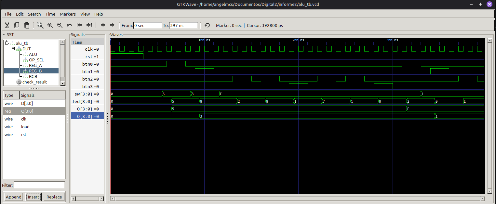

# Laboratorio 02  
## Diseño, simulación e implementación de una ALU de 4 bits

---

## Integrantes

- Andres Felipe Castro Lopez – 1014298415
- Juan Pablo Castañeda Moncada - 1000851451
- Angel Manuel Cortavarria Salas – 1044213907

**Grupo de trabajo:** 4  
**Semestre:** 2026-2 

---

## Índice
- [Diseño implementado](#diseño-implementado)
- [Simulaciones](#simulaciones)
- [Implementación](#implementación)
- [Conclusiones](#conclusiones)
- [Referencias](#referencias)

---

## Diseño implementado

El diseño está compuesto por regustros de 4 bits,
una unidad de control para la selección de operaciones y un
módulo de visualización mediante LEDs.

El sistema combina lógica secuencial, utilizada para almacenar
los operandos y seleccionar la operación, con lógica combinacional,
encargada de realizar las operaciones aritméticas y lógicas.

### Estados y operaciones

El selector utiliza dos bits, `op[1:0]`, para representar
las cuatro operaciones disponibles:

| Código `op[1:0]` | Operación | Color del LED RGB |
|:---:|---|---|
| `00` | Suma: A + B | Verde |
| `01` | Resta: A - B | Rojo |
| `10` | AND: A & B | Azul |
| `11` | OR: A \| B | Blanco |

Estos cuatro códigos representan los modos de operación del
sistema. El selector cambia los bits de operación al detectar
las pulsaciones de los botones correspondientes.

### Funcionamiento general

1. Los interruptores `sw[3:0]` permiten introducir los operandos.
2. El botón `btn0` almacena el valor de los interruptores en A.
3. El botón `btn1` almacena el valor de los interruptores en B.
4. Los botones `btn2` y `btn3` modifican la operación seleccionada.
5. La ALU calcula continuamente el resultado según A, B y `op`.
6. Los LEDs `led[3:0]` muestran el resultado binario de la operación.
7. El LED RGB indica la operación seleccionada.


## Simulaciones
 
### Descripción del testbench
 
 El testbench (`alu_tb.v`) instancia el módulo `top` completo, así que se prueban juntos los registros de los operandos, el selector de operación, la ALU y el controlador del LED RGB, y no solo la ALU por separado.
 
El reloj tiene un periodo de 10 ns y el reset es activo en alto, se mantiene durante los primeros 4 ciclos. Las pulsaciones de los botones se generan en el flanco de bajada del reloj y duran dos ciclos, para que los cambios en las entradas no coincidan con el flanco de subida en el que se muestrean. Todas las señales del diseño se guardan en `alu_tb.vcd`.
 
 
Primero se cargan A = 5 y B = 3 y se recorren las cuatro operaciones sin tocar los operandos. Después se carga A = 15 y B = 1 para probar valores en los extremos y el desbordamiento de 4 bits.
 
### Señales observadas
 
En GTKWave se observaron `clk`, `rst`, `btn0` a `btn3`, `sw[3:0]`, el código de operación `op[1:0]` del módulo `OP_SEL`, los operandos A y B (salida `Q` de `REG_A` y `REG_B`), el resultado `led[3:0]` y las salidas `led_r`, `led_g` y `led_b`.
 
### Resultados obtenidos
 
- Al poner `sw = 1111` en el paso 4 ni A ni B cambian, solo se actualizan al pulsar `btn0` o `btn1`. Al cargar A en el paso 11, B sigue en 3, y al cargar B en el paso 12, A sigue en 15.
- Cada pulsación de `btn2` o `btn3` cambia un solo bit de `op`, aunque el botón esté en alto durante dos ciclos de reloj, porque el selector detecta flancos. Al soltar el botón la operación se mantiene y el resultado no cambia hasta la siguiente pulsación.
- Se Coincide con lo esperado en las cuatro operaciones: 5 + 3 = 8, 5 − 3 = 2, 0101 AND 0011 = 0001 y 0101 OR 0011 = 0111. Con los nuevos operandos, 15 − 1 = 14 (1110).
- `led` cambia en el mismo instante en que cambia un registro o el código de operación, sin esperar otro flanco de reloj, porque la ALU no tiene registro de salida.
- Como el resultado es de 4 bits, 15 + 3 = 18 se muestra como 0010 (2) y 15 + 1 = 16 se muestra como 0000 (0). Se descartan los bits que no caben.
- `led_r`, `led_g` y `led_b` cambian cada vez que cambia `op`, según la tabla de colores de la sección de diseño.
### Evidencias
 

 
*Simulación del sistema completo en GTKWave.*


---


## Implementación

### Organización del código

El diseño se implementó en Verilog mediante una arquitectura modular, con el objetivo de separar las funciones de almacenamiento, selección de operaciones, procesamiento y visualización. El módulo principal `top.v` integra los componentes y establece las conexiones entre las entradas y salidas físicas de la FPGA.

El código fuente se organiza en la carpeta `src/` de la siguiente manera:

```text
src/
├── top.v
├── registro.v
├── op_selector.v
├── alu.v
└── rgb_ctrl.v
```

### Módulos implementados

- **`top.v` — Módulo principal:** integra los módulos del sistema y establece las conexiones entre las entradas físicas de la FPGA, los registros, la ALU y las salidas de visualización. Recibe los valores de los interruptores y los botones, y envía el resultado de la operación a los LEDs.

- **`registro.v` — Almacenamiento de operandos:** implementa un registro de 4 bits que almacena el valor presente en los interruptores `sw[3:0]` cuando se activa la señal `load` en un flanco positivo del reloj `clk`.

- **`op_selector.v` — Selector de operaciones:** genera el código de operación de 2 bits `op[1:0]` a partir de los botones `btn2` y `btn3`. Cada botón modifica uno de los bits del código al detectar una pulsación, permitiendo seleccionar entre las cuatro operaciones disponibles. El módulo incorpora sincronización de las entradas con el reloj para reducir los riesgos asociados a señales asíncronas.

- **`alu.v` — Unidad aritmético-lógica:** procesa los operandos A y B, ambos de 4 bits, y ejecuta la operación indicada por `op[1:0]`. Su implementación es completamente combinacional, por lo que el resultado se actualiza automáticamente cuando cambian los operandos o el código de operación. Las operaciones disponibles son suma, resta, AND bit a bit y OR bit a bit.

- **`rgb_ctrl.v` — Controlador del LED RGB:** decodifica el código de operación y establece las señales de control de los componentes rojo, verde y azul del LED RGB. De esta manera, permite identificar visualmente la operación seleccionada sin necesidad de consultar el código binario.

###  Manejo del reloj y reset

El sistema utiliza la señal de reloj `clk` para controlar los elementos secuenciales. Los módulos `registro.v` y `op_selector.v` actualizan sus valores en el flanco positivo del reloj, mientras que la ALU y el controlador RGB implementan lógica combinacional.

Los registros de operandos capturan el valor de los interruptores `sw[3:0]` cuando se activa la señal de carga correspondiente. El botón `btn0` controla la carga del operando A, mientras que `btn1` controla la carga del operando B.

En el selector de operaciones, las señales de los botones `btn2` y `btn3` se sincronizan con el reloj y se comparan con sus valores anteriores para detectar flancos ascendentes. Esta estrategia permite identificar las pulsaciones y actualizar el código de operación.

### 3. Comportamiento esperado del sistema

El funcionamiento del sistema se desarrolla en las siguientes etapas:

1. **Entrada de datos:** el usuario establece un valor binario de 4 bits mediante los interruptores `sw[3:0]`.
2. **Almacenamiento:** al pulsar `btn0`, el valor se almacena en el registro A; al pulsar `btn1`, se almacena en el registro B.
3. **Selección de operación:** los botones `btn2` y `btn3` modifican los bits del código `op[1:0]`, que determina la operación de la ALU.
4. **Procesamiento combinacional:** la ALU calcula continuamente el resultado a partir de A, B y el código de operación, sin utilizar un registro de salida.
5. **Visualización:** las salidas `led[3:0]` muestran el resultado binario, mientras que `led_r`, `led_g` y `led_b` indican la operación seleccionada mediante el LED RGB.

Las operaciones implementadas son:

| Código `op[1:0]` | Operación | Color RGB |
|:---:|---|---|
| `00` | Suma: A + B | Verde |
| `01` | Resta: A - B | Rojo |
| `10` | AND bit a bit | Azul |
| `11` | OR bit a bit | Blancoo |

El resultado de la ALU tiene un ancho de 4 bits. Por ello, en las operaciones aritméticas se conservan únicamente los cuatro bits menos significativos, descartando cualquier acarreo o préstamo que no forme parte de ese ancho.

## Conclusiones
 
Con este laboratorio quedó clara la diferencia entre la parte que guarda información y la que solo calcula. Los registros de A, B y el código de operación son los únicos elementos con memoria. La ALU no guarda nada y su resultado depende solo de lo que tenga en ese momento en sus entradas, por eso en la simulación el resultado cambia en el mismo instante en que cambia un registro o el código de operación.
 
Se observo que dividir el diseño en módulos (registro, selector, ALU y controlador RGB) hace más fácil revisar cada parte, y que `top.v` se queda solo con las conexiones. Otro punto importante fue el manejo de los botones: al detectar flancos en vez de leer el nivel, cada pulsación cambia un bit del código una sola vez aunque el botón se mantenga presionado varios ciclos. 
 
 
La selección de la operación, con los botones `btn2` y `btn3` no eligen una operación directamente sino que invierten un bit del código. Pasar de una operación a otra puede requerir más de una pulsación, por ejemplo de 01 a 10 hay que pulsar los dos botones. También hubo que cuidar la sincronización de los botones con el reloj y que en el testbench los cambios de las entradas no coincidieran con el flanco de subida.
 
 
Se pudo comprobar que los operandos se conservan al mover los switches y que la operación sigue seleccionada al soltar los botones, antes de programar la tarjeta. La simulación también permitió revisar casos como el desbordamiento de la suma, y cada cambio en el diseño se puede volver a probar corriendo el mismo testbench.


---

## Referencias


