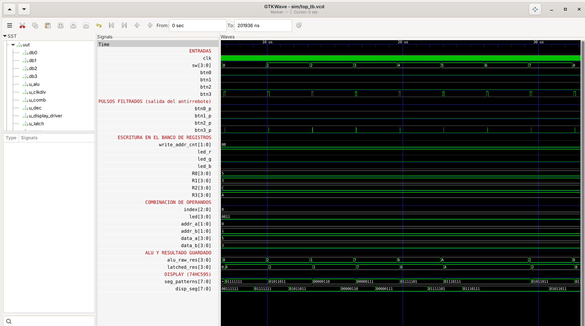
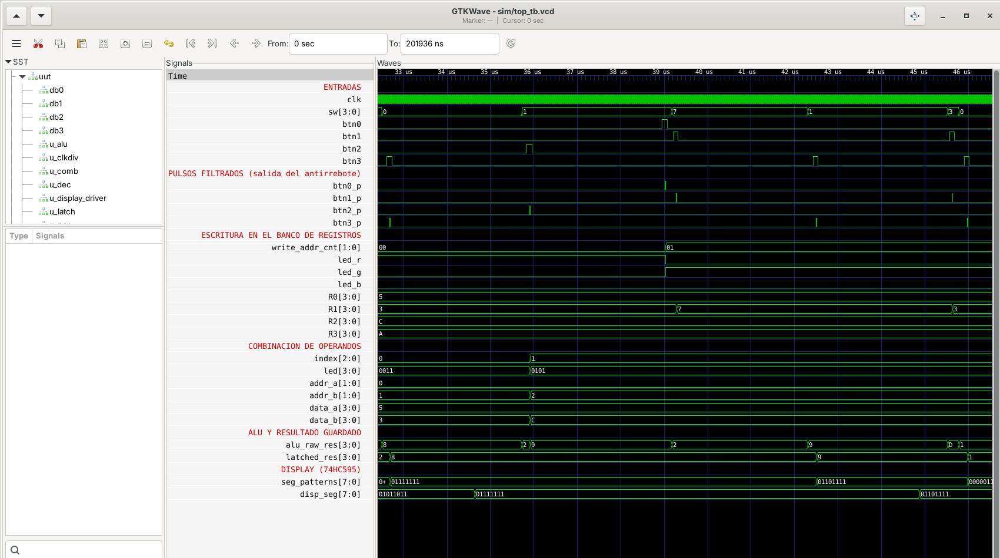

# Laboratorio 03
## ALU + Banco de Registros + Diseño Modular

---

## Integrantes

- Andres Felipe Castro Lopez – 1014298415
- Juan Pablo Castañeda Moncada - 1000851451
- Angel Manuel Cortavarria Salas – 1044213907

**Grupo de trabajo:** 4  
**Semestre:** 2026-2

---

## Índice
- [Descripción del sistema](#descripción-del-sistema)
- [Arquitectura modular](#arquitectura-modular)
- [Simulaciones](#simulaciones)
- [Implementación en FPGA](#implementación-en-fpga)
- [Conclusiones](#conclusiones)
- [Referencias](#referencias)

---

## Descripción del sistema

El sistema es un pequeño procesador de datos de 4 bits construido a partir de módulos independientes. Está formado por un **banco de 4 registros de 4 bits (R0–R3)**, una **ALU de 4 bits con 8 operaciones**, un **selector automático de operandos** que recorre las 6 parejas posibles de registros, un **registro de resultado** que conserva la última operación ejecutada y un **módulo de visualización** que muestra el resultado en un display de 7 segmentos.

El flujo de uso es el siguiente:

1. Se almacenan datos en los registros R0–R3.
2. Se elige una pareja de registros (A, B) como operandos.
3. Se selecciona la operación con los switches y se ejecuta con `BTN3`.
4. El resultado queda guardado y visible en el display hasta la siguiente ejecución.

La característica central del diseño es que **el display no sigue a la ALU**: solo se actualiza cuando se pulsa `BTN3`. Si después cambian los registros, la pareja seleccionada o la operación, el display conserva el resultado de la última ejecución.

### Interfaz de usuario (Zybo Z7)

| Elemento | Función |
|---|---|
| `SW[3:0]` | Dato de 4 bits que se escribe en el registro seleccionado |
| `SW[2:0]` | Selección de la operación de la ALU (se leen en el momento de pulsar `BTN3`) |
| `BTN0` | Avanza el registro seleccionado para escritura (R0 → R1 → R2 → R3 → R0) |
| `BTN1` | Escribe `SW[3:0]` en el registro seleccionado |
| `BTN2` | Cambia a la siguiente pareja de operandos (A, B) |
| `BTN3` | Ejecuta la operación y actualiza el resultado mostrado |
| `LED[3:0]` | Registros activos como operandos (LED0 = R0, LED1 = R1, LED2 = R2, LED3 = R3) |
| LED RGB | Registro seleccionado para escritura |
| Display 7 segmentos | Resultado de la última operación ejecutada (hexadecimal) |

### Operaciones de la ALU

La operación se elige con `SW[2:0]`:

| `SW[2:0]` | Operación | Descripción |
|:---:|---|---|
| `000` | A + B | Suma (se descarta el acarreo) |
| `001` | A − B | Resta (resultado módulo 16) |
| `010` | A & B | AND bit a bit |
| `011` | A \| B | OR bit a bit |
| `100` | A ^ B | XOR bit a bit |
| `101` | ~A | NOT de A |
| `110` | A << 1 | Desplazamiento a la izquierda |
| `111` | A >> 1 | Desplazamiento a la derecha |

Las operaciones `~A`, `A << 1` y `A >> 1` solo usan el operando A; el operando B se ignora.

### Selección de operandos

Con 4 registros existen 6 parejas distintas. `BTN2` las recorre en orden y, tras la última, vuelve a la primera:

| Índice | Operando A | Operando B | `LED[3:0]` |
|:---:|:---:|:---:|:---:|
| 0 | R0 | R1 | `0011` |
| 1 | R0 | R2 | `0101` |
| 2 | R0 | R3 | `1001` |
| 3 | R1 | R2 | `0110` |
| 4 | R1 | R3 | `1010` |
| 5 | R2 | R3 | `1100` |

### Indicador del registro de escritura (LED RGB)

| Registro seleccionado | Color del LED RGB |
|:---:|---|
| R0 | Rojo |
| R1 | Verde |
| R2 | Azul |
| R3 | Amarillo (rojo + verde) |

### Procedimiento de uso

**Escribir un dato:**
1. Poner el dato en `SW[3:0]`.
2. Pulsar `BTN0` hasta que el LED RGB muestre el color del registro deseado.
3. Pulsar `BTN1` para escribir.

**Ejecutar una operación:**
1. Pulsar `BTN2` hasta que los `LED[3:0]` muestren la pareja de registros deseada.
2. Poner el código de la operación en `SW[2:0]`.
3. Pulsar `BTN3`. El resultado aparece en el display y permanece hasta la siguiente ejecución.


---

## Arquitectura modular

El sistema se dividió en módulos pequeños, cada uno con una única responsabilidad. `top.v` solo instancia los módulos y los conecta con los pines físicos.

### Módulos implementados

| Módulo | Archivo | Tipo | Función |
|---|---|---|---|
| Principal | `top.v` | Integración | Instancia los módulos, conecta botones, switches, LEDs y display. Contiene además el contador de 2 bits `write_addr_cnt` (avanza con `BTN0`) y el decodificador del LED RGB. |
| ALU | `alu.v` | Combinacional | Calcula la operación `op[2:0]` entre `a` y `b`. No tiene registro de salida. |
| Banco de registros | `reg_bank.v` | Secuencial (escritura) / combinacional (lectura) | 4 registros de 4 bits. Escribe en `write_addr` cuando `we = 1` en el flanco de subida; las dos lecturas son asíncronas. |
| Selector de combinaciones | `comb_selector.v` | Secuencial + combinacional | Mantiene un índice de 0 a 5 que avanza con `next_comb`; decodifica el índice en `addr_a`, `addr_b` y `leds_active`. |
| Registro de resultado | `result_latch.v` | Secuencial | Guarda el resultado de la ALU solo cuando llega el pulso `execute` (`BTN3`). Es el que garantiza que el display conserve la última operación. |
| Antirrebote | `debouncer.v` | Secuencial | Exige que la entrada se mantenga estable 1 250 000 ciclos (10 ms a 125 MHz) y entrega un pulso de un solo ciclo en el flanco ascendente filtrado. Hay una instancia por botón. |
| Decodificador 7 segmentos | `hex_to_7seg.v` | Combinacional | Convierte un nibble (0–F) en el byte de segmentos `[DP, G, F, E, D, C, B, A]`. |
| Driver del display | `hc595_driver.v` | Secuencial (FSM) | Envía el byte de segmentos en serie al registro de desplazamiento 74HC595 y lo refresca de forma continua. |
| Divisor de reloj | `clk_divider.v` | Secuencial | Genera `clk_slow` ≈ 50 kHz a partir del reloj de 125 MHz para el driver del display. |


La máquina de estados de `hc595_driver.v` repite continuamente el siguiente ciclo sobre `clk_slow`:

| Estado | Acción |
|---|---|
| `ST_IDLE` | Captura `seg0` en un registro de desplazamiento interno y reinicia el contador de bits |
| `ST_SHIFT_LOW` | Coloca el bit actual (de MSB a LSB) en `ds` y baja `sh_cp` |
| `ST_SHIFT_HIGH` | Sube `sh_cp`; el 74HC595 ingresa el bit. Tras el bit 7 pasa al latch |
| `ST_LATCH_LOW` | Baja `sh_cp` y `st_cp` |
| `ST_LATCH_HIGH` | Sube `st_cp`; el chip copia los 8 bits a sus salidas |
| `ST_HOLD` | Baja `st_cp` y vuelve a `ST_IDLE` |

Un ciclo completo toma 20 periodos de `clk_slow`, es decir, el display se refresca a unos 2,5 kHz.

### Manejo del reloj y reset

Todo el sistema trabaja con el reloj de 125 MHz de la Zybo Z7, excepto el driver del display, que usa `clk_slow` (≈ 50 kHz, obtenido dividiendo 125 MHz entre 2 × 1250). La señal `rst` está fija en `1'b0` dentro de `top.v`, por lo que el diseño no tiene reset externo y depende de que los registros arranquen en cero, que es el valor inicial por defecto de las celdas de la FPGA tras la configuración.

---


El resultado de la ALU tiene 4 bits, es decir, 16 valores posibles (0–15). Se eligió el **sistema hexadecimal con un único dígito** para todas las operaciones, por las siguientes razones:

- Un dígito hexadecimal representa exactamente un nibble, así que cada resultado posible tiene una representación única y de un solo carácter.
- El decimal no cabe en un dígito (10–15 requieren dos), y el binario necesitaría cuatro dígitos.
- Usar la misma representación para suma, resta y operaciones lógicas evita ambigüedades sobre cómo interpretar el display.

El módulo `hex_to_7seg.v` genera los patrones para un display de cátodo común (nivel alto enciende el segmento). Las letras `b` y `d` se muestran en minúscula para no confundirlas con el `8` y el `0`:

| Resultado (binario) | Decimal | Display |
|:---:|:---:|:---:|
| `0000` | 0 | `0` |
| `0001` | 1 | `1` |
| `0010` | 2 | `2` |
| `0011` | 3 | `3` |
| `0100` | 4 | `4` |
| `0101` | 5 | `5` |
| `0110` | 6 | `6` |
| `0111` | 7 | `7` |
| `1000` | 8 | `8` |
| `1001` | 9 | `9` |
| `1010` | 10 | `A` |
| `1011` | 11 | `b` |
| `1100` | 12 | `C` |
| `1101` | 13 | `d` |
| `1110` | 14 | `E` |
| `1111` | 15 | `F` |


- **Suma:** si A + B supera 15, el display muestra los 4 bits menos significativos (por ejemplo, 12 + 10 = 22 se muestra como `6`).
- **Resta:** el resultado es módulo 16. Si A < B, el valor se interpreta en complemento a dos (por ejemplo, 5 − 12 = −7 se muestra como `9`).
- **Operaciones lógicas y desplazamientos:** el resultado se interpreta bit a bit; el valor hexadecimal mostrado equivale a los 4 bits resultantes.

**Persistencia:** el valor mostrado proviene de `result_latch.v`, no directamente de la ALU. Por eso el display solo cambia cuando se pulsa `BTN3`.

---

## Simulaciones

El testbench (`tb/top_tb.v`) instancia el módulo `top` completo para verificar el sistema integrado y no solo la ALU.

**Prueba 1 – Las 8 operaciones sobre la pareja (R0, R1): A = 5, B = 3**
| `SW[2:0]` | Operación | Resultado (bin) | Display esperado |
|:---:|---|:---:|:---:|
| `000` | 5 + 3 | `1000` | `8` |
| `001` | 5 − 3 | `0010` | `2` |
| `010` | 0101 & 0011 | `0001` | `1` |
| `011` | 0101 \| 0011 | `0111` | `7` |
| `100` | 0101 ^ 0011 | `0110` | `6` |
| `101` | ~0101 | `1010` | `A` |
| `110` | 0101 << 1 | `1010` | `A` |
| `111` | 0101 >> 1 | `0010` | `2` |





**Prueba 2– Persistencia del resultado**
1. En la pareja (R0, R1) se ejecuta la suma → el display debe mostrar `8`.
2. Se cambia `SW[2:0]` a otra operación y se pulsa `BTN2` para pasar a (R0, R2) → el display debe seguir en `8`.
3. Se modifica un registro con `BTN0` y `BTN1` → el display debe seguir en `8`.
4. Se pulsa `BTN3` con `SW[2:0] = 001` → el display debe cambiar a `9` (5 − 12).
 



 
El archivo de formas de onda completo está en `sim/top_tb.vcd`.


---

## Implementación en FPGA

### Organización del código

```text
├── src/
│   ├── top.v
│   ├── alu.v
│   ├── reg_bank.v
│   ├── comb_selector.v
│   ├── result_latch.v
│   ├── debouncer.v
│   ├── hex_to_7seg.v
│   ├── hc595_driver.v
│   └── clk_divider.v
```

### Asignación de pines

Las asignaciones de pines están en `constraints/zybo_z7.xdc`. Las señales del diseño se asocian así:

| Señal | Elemento físico |
|---|---|
| `clk` | Reloj de 125 MHz de la Zybo Z7 |
| `sw[3:0]` | Switches SW0–SW3 |
| `btn0`–`btn3` | Botones BTN0–BTN3 |
| `led[3:0]` | LEDs LD0–LD3 |
| `led_r`, `led_g`, `led_b` | LED RGB |
| `ds`, `sh_cp`, `st_cp` | Entradas SER, SRCLK y RCLK del 74HC595 (conector Pmod) |

### Evidencia del funcionamiento


https://github.com/user-attachments/assets/f97526a6-a839-4398-a30d-82266c97e28b


---

## Conclusiones
Este laboratorio me dejó claro que un sistema digital completo funciona mucho mejor cuando se arma a partir de módulos pequeños que se pueden probar por separado. Cada bloque (ALU, banco de registros, selector, registro de resultado, antirrebote, decodificador y driver) tiene una función bien definida, y al final la integración se resume básicamente a conectar bien las señales entre ellos.

Lo que más marcó la diferencia para cumplir el requisito principal fue entender bien la distinción entre lógica combinacional y secuencial. La ALU está calculando todo el tiempo, pero el result_latch es el único que decide cuándo ese resultado se “congela” y se muestra. Gracias a eso el display se mantiene estable aunque cambien los operandos, la operación o cualquier otra cosa.

Por último, usar un solo dígito en hexadecimal resultó suficiente para mostrar sin ambigüedad cualquier resultado de 4 bits. Eso sí, hay que tener presente que los valores desbordados de la aritmética modular se interpretan de forma distinta.

---

## Referencias
[1]: S. L. Harris y D. Harris, *Digital Design and Computer Architecture: RISC-V Edition*. Waltham, MA, USA: Morgan Kaufmann, 2021.

[2]: Texas Instruments, *SN74HC595 8-Bit Shift Registers With 3-State Output Registers*, hoja de datos.

[3]: Digilent, *Zybo Z7 Reference Manual*.
