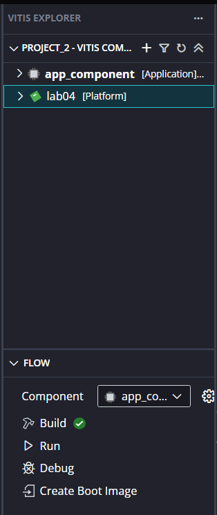

# Laboratorio 04  
## Lab04 – SoC Zynq-7000

 ---

## Integrantes

- Andres Felipe Castro Lopez – 1014298415
- Juan Pablo Castañeda Moncada - 1000851451
- Angel Manuel Cortavarria Salas– 1044213907

**Grupo de trabajo:** G4  
**Semestre:** 2026-2  

---

## Índice

- [Evidencias](#evidencias)
- [Referencias](#referencias)

---

## Evidencias

Configuración de proyecto : Verifica la creación del proyecto Lab04 apuntando directamente a la tarjeta Zybo Z7-10 (xc7z010clg400-1) con lenguaje objetivo Verilog

Integración de periféricos : Muestra la etapa intermedia al añadir el bloque axi_gpio_0 con las interfaces leds_4bits y btns_4bits desde la pestaña Board antes de ejecutar la conexión automática.

Diagrama de bloques final : Evidencia el SoC completo y organizado tras Regenerate Layout, conectando processing_system7_0 y proc_sys_reset_0 a través de axi_interconnect_0 hacia axi_bram_ctrl_0 (blk_mem_gen_0) y axi_gpio_0. Además, confirma que el canal 1 (GPIO) quedó asignado a btns_4bits y el canal 2 (GPIO2) a leds_4bits, lo cual coincide exactamente con las definiciones BTN_CHANNEL 1 y LED_CHANNEL 2 de src/main.c.

Entorno Vitis : Muestra en Vitis Explorer (LAB04 - VITIS COMPONENTS) la plataforma de hardware platform [Platform] junto con la aplicación app_component [Application] [standalone_ps7_cortexa9_0].

Se observa tambien que el proyecto se contruyó sin errores.

Video del funcionamiento en la FPGA: Después de realizar la implementación así se ve en la FPGA.

https://github.com/user-attachments/assets/eb046b8f-3da0-4dc6-8fd3-0d70f242470b

## Referencias

- AMD. (s. f.). *SoC AMD Zynq™ 7000*. Advanced Micro Devices, Inc.
- Digilent. (s. f.). *Zybo Z7 Reference Manual & Board Files*. Digilent Inc.
- FPGAs for Beginners. (2023, 28 de julio). *Zynq Part 1: Vivado block diagram (no Verilog/VHDL necessary!)* [Video]. YouTube.

